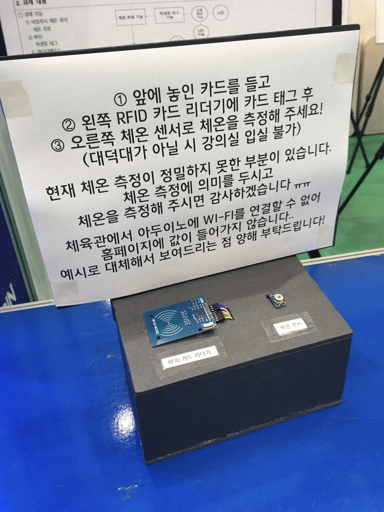
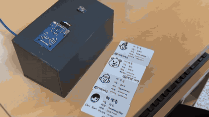
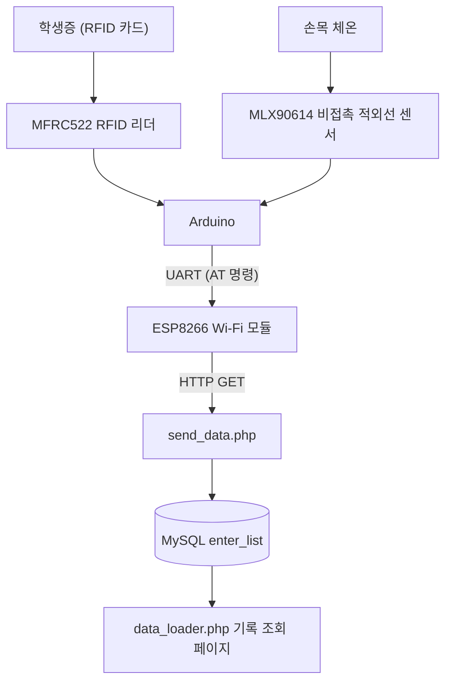

# RFID + 비접촉 체온 측정 출결(방문기록) 시스템

강의실에 들어가기 전에 **학생증(RFID)을 태그하고 체온을 측정**하면, 그 기록이 서버 DB에 저장되고 **웹 페이지에서 조회**되는 시스템입니다.
코로나19 확산 방지를 목표로 대덕대학교 컴퓨터정보학과 캡스톤디자인(2021)에서 만들었습니다.



> 2021 BIG人 창의융복합제 캡스톤디자인 경진대회 전시 모습입니다. 왼쪽이 RFID 카드 리더기, 오른쪽이 비접촉 체온 센서입니다.

## 시연 영상

[](docs/demo.mp4)

이미지를 누르면 전체 영상을 볼 수 있습니다. 직접 꾸민 시연용 카드를 태그하면 등록된 카드는 카드 번호와 체온이 출력되고, 등록되지 않은 카드는 거부됩니다.

전시는 체육관에만 작품을 놓을 수 있어서 현장에서는 Wi-Fi를 쓸 수 없었습니다. 그래서 실제 동작 모습은 이 영상으로 대신 보여드렸습니다. 개발 중에는 카드 태그 → 체온 측정 → 서버 등록 → DB 저장 → 웹 조회까지 전체 흐름이 동작했습니다.

## 프로젝트 정보

| 항목 | 내용 |
|---|---|
| 기간 / 인원 | 2021년 / 2명 (강민수, 최규석) |
| 역할 | 2인 공동 개발. 인원이 적어 분야를 나누지 않고 설계, 펌웨어, 서버·DB, 웹 조회 페이지를 함께 만들었습니다. |
| 사용 기술 | Arduino C++, MFRC522(RFID), MLX90614(비접촉 적외선 온도 센서), ESP8266(Wi-Fi), PHP, MySQL |
| 수상 | 금상 (컴퓨터정보학과 1위) |
| 발표 | 「방문기록 시스템 설계」, 한국멀티미디어학회 2021 추계학술발표대회 |

## 만든 이유

시중 체온계는 기능이 다양한 만큼 가격이 비쌉니다. 저렴하고 누구나 도전할 수 있는 아두이노에 체온 측정과 RFID 신원 확인을 합치면, 누가 언제 어느 강의실에 들어갔고 체온이 어땠는지를 저렴하게 기록할 수 있다고 생각했습니다.

## 시스템 구조



동작 순서는 다음과 같습니다.

1. 학생증을 리더기에 태그합니다.
2. 아두이노가 카드 UID가 등록된 카드인지 확인합니다. 등록되지 않은 카드는 거부하고 기록하지 않습니다.
3. 등록된 카드이면 비접촉 센서로 체온을 20회 측정해 평균을 냅니다.
4. 강의실 번호, 카드 ID, 체온을 ESP8266(AT 명령)으로 `send_data.php` 에 HTTP GET 으로 보냅니다.
5. 서버가 `enter_list` 테이블에 저장하고, `data_loader.php` 가 기록을 표로 보여줍니다.

## 폴더 구조

```
firmware/
├── rfid_temp_wifi/          # 최종 구성: RFID + 체온 + Wi-Fi 전송
├── rfid_temp_serial/        # 서버 없이 시리얼 모니터로 확인하는 데모 버전
└── tools/
    └── rfid_uid_reader/     # 카드 UID 확인용 (ALLOWED_UIDS 에 넣을 값 출력)
web/
├── send_data.php            # 아두이노 요청을 받아 DB에 저장하는 API
├── data_loader.php          # 기록 조회 페이지
└── config.example.php       # DB 접속 설정 예시
db/
└── schema.sql               # enter_list 테이블 + 예시 데이터
docs/
├── wiring.md                # 배선 참고표
├── demo.mp4                 # 시연 영상
└── images/                  # 사진, 미리보기 GIF
```

## 실행해 보기

### 1) 서버 + DB (하드웨어 없이 확인 가능)

1. MySQL에서 `db/schema.sql` 을 실행합니다.
2. `web/` 을 Apache(PHP)의 htdocs 에 올리고, `config.example.php` 를 `config.php` 로 복사해 DB 계정을 입력합니다.
3. 아두이노 대신 `curl` 로 요청을 보내 확인합니다.

   ```bash
   curl "http://localhost/send_data.php?room=10613&rfid=1234567&temp=36"   # -> OK
   ```
4. 브라우저에서 `http://localhost/data_loader.php` 를 열어 방금 기록이 보이는지 확인합니다.

### 2) 센서만 확인 (서버 불필요)

1. Arduino IDE 라이브러리 관리자에서 `MFRC522`, `Adafruit MLX90614` 를 설치합니다. (`Adafruit BusIO` 가 함께 필요하면 같이 설치)
2. [`docs/wiring.md`](docs/wiring.md) 를 참고해 배선합니다.
3. `tools/rfid_uid_reader` 를 업로드하고 학생증을 태그해 UID를 확인한 뒤, 출력된 `{ 0x.., ... }` 값을 `rfid_temp_serial.ino` 의 `ALLOWED_UIDS` 에 붙여 넣습니다.
4. `rfid_temp_serial` 을 업로드하면 시리얼 모니터(9600)에서 태그 → 체온 측정 → 결과 출력을 확인할 수 있습니다.

### 3) 전체 시스템

1. ESP8266 에 AT 펌웨어를 올리고 통신 속도를 9600 으로 맞춥니다.
2. `rfid_temp_wifi.ino` 상단 "설정"의 Wi-Fi 이름/비밀번호, 서버 IP, 강의실 번호, `ALLOWED_UIDS` 를 수정해 업로드합니다.
3. 카드를 태그하고 체온을 측정하면 `data_loader.php` 에 기록이 나타납니다.

## 서버 API

`GET /send_data.php`

| 파라미터 | 설명 | 예 |
|---|---|---|
| `room` | 강의실 번호 | `10613` |
| `rfid` | 카드 UID 4바이트를 10진수로 이어 붙인 값 | `35142557` |
| `temp` | 측정 체온(℃, 정수 평균) | `36` |

성공하면 `OK`, 파라미터가 빠지면 `400`, DB 연결에 실패하면 `500` 을 돌려줍니다.

DB 테이블 `enter_list` 는 `room`(강의실), `RF_id`(카드 UID), `temperature`(체온), `date`(기록 시간, 기본값 `CURRENT_TIMESTAMP`) 네 컬럼입니다.

## 참고

- 공개를 위해 Wi-Fi·DB 비밀번호와 서버 주소를 설정값으로 분리한 코드입니다.
- 사용한 라이브러리: [MFRC522](https://github.com/miguelbalboa/rfid), [Adafruit MLX90614](https://github.com/adafruit/Adafruit-MLX90614-Library)
